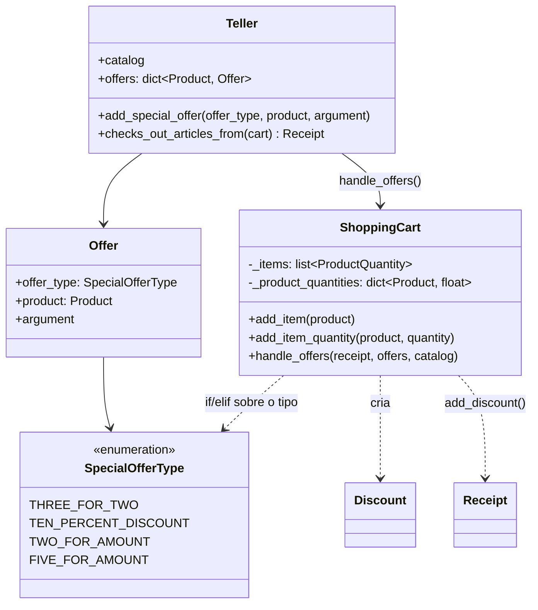
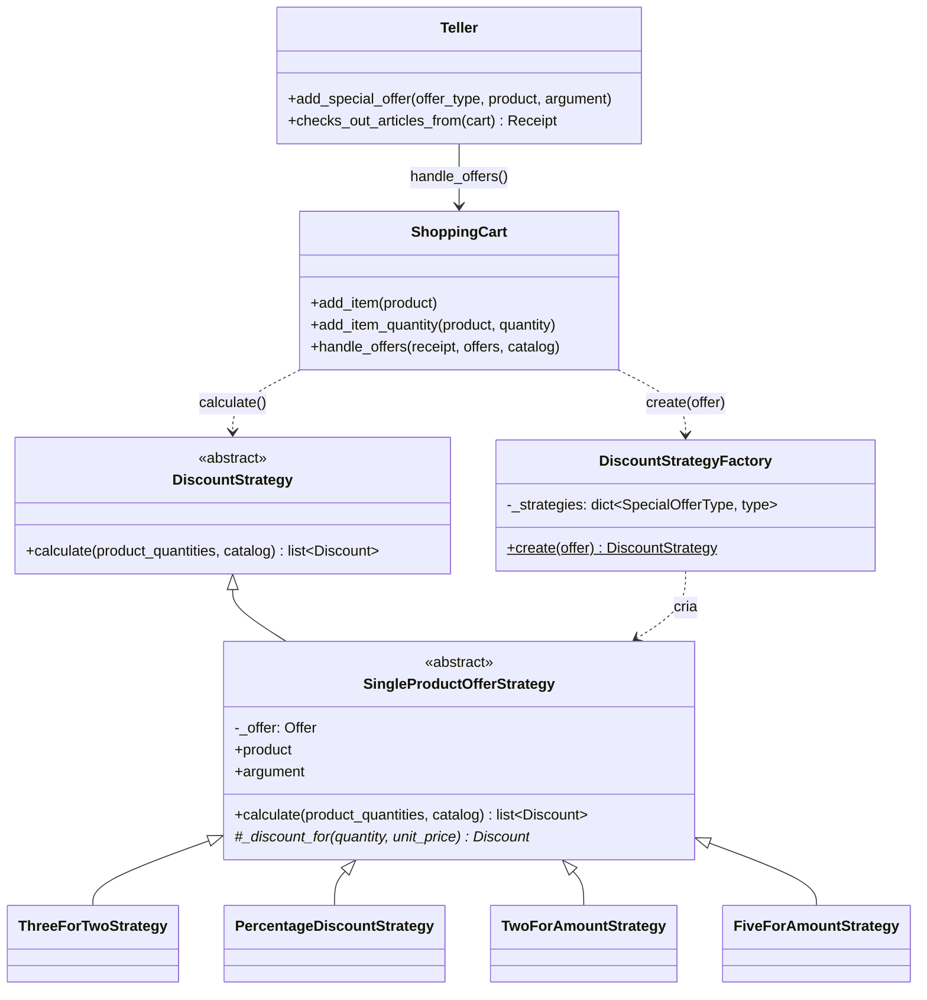

# Padrões de projeto, SOLID e Clean Code

> Dono: **P3** (seção de combo: P4) · Enunciado: Passo 8 e item 5.5 · Barema: 2,0 + 2,0

Resumo: o cálculo de ofertas saiu de um único método com cadeia de `if`s
(`ShoppingCart.handle_offers`) para **uma classe por modalidade de oferta**
(Strategy), com os passos comuns numa classe base (Template Method) e a
escolha da classe concentrada numa fábrica (Factory Method). A API pública
não mudou (decisão D7) e os testes de caracterização da P2 passam sem
alteração antes e depois.

## 1. Antes: diagrama de classes do legado



Problemas (detalhados em `docs/diagnostico_tecnico.md`):

- `handle_offers` tinha cerca de 40 linhas com **todas** as regras de desconto,
  `if`/`elif` sobre `SpecialOfferType` intercalados e variáveis sem
  significado (`x`, `number_of_x`, `p`, `discount_n`).
- O carrinho acumulava duas responsabilidades: guardar itens **e** conhecer
  cada regra comercial.
- Adicionar uma promoção (ex.: combos) exigia editar o meio desse método,
  com risco de regressão nas ofertas existentes.
- Não era possível testar uma regra isoladamente; só via `Teller` + `Receipt`.

## 2. Padrão 1: Strategy

- **Problema que resolve:** cada modalidade de oferta é um algoritmo de
  desconto diferente, escolhido em tempo de execução pelo tipo da oferta. No
  legado esses algoritmos estavam misturados no mesmo método. Com Strategy,
  cada regra vira uma classe que implementa o contrato comum
  `DiscountStrategy.calculate(product_quantities, catalog) -> list[Discount]`
  (decisão D5), e o carrinho passa a trabalhar só com esse contrato.

| Oferta (`SpecialOfferType`) | Estratégia |
|-----------------------------|------------|
| `THREE_FOR_TWO` | `src/offers/three_for_two.py` → `ThreeForTwoStrategy` |
| `TEN_PERCENT_DISCOUNT` | `src/offers/percentage_discount.py` → `PercentageDiscountStrategy` |
| `TWO_FOR_AMOUNT` | `src/offers/two_for_amount.py` → `TwoForAmountStrategy` |
| `FIVE_FOR_AMOUNT` | `src/offers/five_for_amount.py` → `FiveForAmountStrategy` |

- **Trecho antes** (`src/shopping_cart.py`, tag `v0-legado`), regra "3 por 2"
  espalhada em dois pontos do método:

```python
x = 1
if offer.offer_type == SpecialOfferType.THREE_FOR_TWO:
    x = 3
# ... outros ifs no meio ...
number_of_x = math.floor(quantity_as_int / x)
if offer.offer_type == SpecialOfferType.THREE_FOR_TWO and quantity_as_int > 2:
    discount_amount = quantity * unit_price - (
                (number_of_x * 2 * unit_price) + quantity_as_int % 3 * unit_price)
    discount = Discount(p, "3 for 2", -discount_amount)
```

- **Trecho depois** (`src/offers/three_for_two.py`), a regra inteira num só lugar:

```python
class ThreeForTwoStrategy(SingleProductOfferStrategy):
    GROUP_SIZE = 3
    PAID_UNITS = 2

    def _discount_for(self, quantity, unit_price):
        whole_units = int(quantity)
        if whole_units < self.GROUP_SIZE:
            return None
        groups = whole_units // self.GROUP_SIZE
        remainder = whole_units % self.GROUP_SIZE
        discount_amount = quantity * unit_price - (
            (groups * self.PAID_UNITS * unit_price) + remainder * unit_price)
        return Discount(self.product, "3 for 2", -discount_amount)
```

  As fórmulas mantêm **a mesma ordem de operações** do legado, para que os
  valores em ponto flutuante do recibo sejam idênticos. O bug do
  `TWO_FOR_AMOUNT` com quantidade ímpar foi preservado de propósito (decisão
  D6) e será corrigido num commit `fix:` separado.

- **Testes relacionados:** `tests/test_offer_strategies.py`
  (`test_three_for_two_strategy`, `test_percentage_discount_strategy`,
  `test_two_for_amount_strategy`, `test_five_for_amount_strategy`), que testam
  cada estratégia **isoladamente**, sem `Teller` nem `Receipt`. A regressão é
  coberta por `tests/test_comportamento_legado.py` (P2), que não foi alterado.

### Padrão complementar: Template Method

As quatro ofertas legadas repetiam os mesmos passos: verificar se o produto
está no carrinho, buscar o preço unitário e devolver o desconto. Esses passos
ficaram em `SingleProductOfferStrategy.calculate`
(`src/offers/single_product_offer.py`), e cada estratégia concreta implementa
apenas o passo variável `_discount_for(quantity, unit_price)`:

```python
def calculate(self, product_quantities, catalog):
    if self.product not in product_quantities:
        return []
    quantity = product_quantities[self.product]
    unit_price = catalog.unit_price(self.product)
    discount = self._discount_for(quantity, unit_price)
    return [discount] if discount is not None else []
```

Teste relacionado: `test_strategy_returns_empty_list_when_product_is_not_in_cart`.

## 3. Padrão 2: Factory Method

- **Problema que resolve:** alguém precisa decidir qual estratégia instanciar
  para cada `Offer`. Se essa decisão ficasse no carrinho, a cadeia de `if`s
  apenas mudaria de lugar. `DiscountStrategyFactory.create(offer)`
  (`src/offers/factory.py`) é o único ponto que conhece as classes concretas:
  ele consulta um registro `SpecialOfferType → classe` e devolve a instância.
  O código cliente recebe um `DiscountStrategy` sem saber qual classe concreta
  foi criada. Trata-se da variante **parametrizada** do Factory Method: um
  único método de criação que decide o produto pelo parâmetro (`offer_type`).

```python
class DiscountStrategyFactory:
    _strategies = {
        SpecialOfferType.THREE_FOR_TWO: ThreeForTwoStrategy,
        SpecialOfferType.TEN_PERCENT_DISCOUNT: PercentageDiscountStrategy,
        SpecialOfferType.TWO_FOR_AMOUNT: TwoForAmountStrategy,
        SpecialOfferType.FIVE_FOR_AMOUNT: FiveForAmountStrategy,
    }

    @classmethod
    def create(cls, offer):
        strategy_class = cls._strategies.get(offer.offer_type)
        if strategy_class is None:
            return None
        return strategy_class(offer)
```

  Tipos de oferta desconhecidos devolvem `None` e não geram desconto, o mesmo
  efeito do legado.

- **Trecho antes/depois** de `ShoppingCart.handle_offers`:

```python
# ANTES (cerca de 40 linhas; trecho)
for p in self._product_quantities.keys():
    quantity = self._product_quantities[p]
    if p in offers.keys():
        offer = offers[p]
        unit_price = catalog.unit_price(p)
        quantity_as_int = int(quantity)
        discount = None
        x = 1
        if offer.offer_type == SpecialOfferType.THREE_FOR_TWO:
            x = 3
        elif offer.offer_type == SpecialOfferType.TWO_FOR_AMOUNT:
            ...
        if discount:
            receipt.add_discount(discount)

# DEPOIS (8 linhas)
for product in self._product_quantities:
    if product not in offers:
        continue
    strategy = DiscountStrategyFactory.create(offers[product])
    if strategy is None:
        continue
    for discount in strategy.calculate(self._product_quantities, catalog):
        receipt.add_discount(discount)
```

  A assinatura `handle_offers(receipt, offers, catalog)` e a ordem dos
  descontos no recibo (ordem de entrada dos produtos no carrinho) foram
  preservadas.

- **Testes relacionados:** `test_factory_creates_strategy_for_each_offer_type`,
  `test_factory_returns_none_for_unknown_offer_type` e
  `test_cart_ignores_offer_with_unknown_type` em `tests/test_offer_strategies.py`.

## 4. Depois: diagrama de classes



## 5. Princípios SOLID aplicados

| Princípio | Onde | Como |
|-----------|------|------|
| **S**ingle Responsibility | `ShoppingCart`, cada estratégia, `DiscountStrategyFactory` | O carrinho guarda itens e delega o desconto; cada estratégia conhece uma única regra; a fábrica só escolhe a classe. |
| **O**pen/Closed | `DiscountStrategyFactory._strategies` | Uma nova oferta é uma nova classe mais uma entrada no registro; `handle_offers` não é editado. |
| **L**iskov Substitution | `DiscountStrategy` | Toda estratégia devolve `list[Discount]` (vazia quando não se aplica), então o carrinho trata todas da mesma forma. Verificado em `test_factory_creates_strategy_for_each_offer_type`. |
| **I**nterface Segregation | `DiscountStrategy` | A interface tem um único método, `calculate`; nenhuma estratégia implementa o que não usa. |
| **D**ependency Inversion | `ShoppingCart.handle_offers` | O carrinho depende da abstração `DiscountStrategy`, não das classes concretas, que só a fábrica conhece. |

Clean Code:

- Nomes com significado: `x` virou `GROUP_SIZE`, `number_of_x` virou `groups`,
  `quantity_as_int` virou `whole_units` e `p` virou `product`.
- Números mágicos viraram constantes (`GROUP_SIZE`, `PAID_UNITS`).
- Métodos curtos, com um nível de abstração cada.
- Imports sem uso removidos (`math`, `SpecialOfferType`, `Discount`).
- Docstrings no padrão PEP 257 em todos os módulos, classes e métodos novos ou
  alterados.

## 6. Como adicionar uma nova promoção (prova de extensibilidade: o combo)

Passos para uma nova oferta de **um único produto**:

1. Criar `src/offers/<nova_oferta>.py` com uma subclasse de
   `SingleProductOfferStrategy` que implemente `_discount_for`.
2. Adicionar o valor em `SpecialOfferType` (somente adição em
   `model_objects.py`) e registrar a classe em
   `DiscountStrategyFactory._strategies`.
3. Escrever os testes unitários da estratégia. `ShoppingCart` e `Teller` não
   mudam.

Promoções que envolvem **vários produtos**, como o combo, implementam
`DiscountStrategy` diretamente, já que `calculate` recebe todas as quantidades
do carrinho.

<!-- Seção do combo: P4 -->
